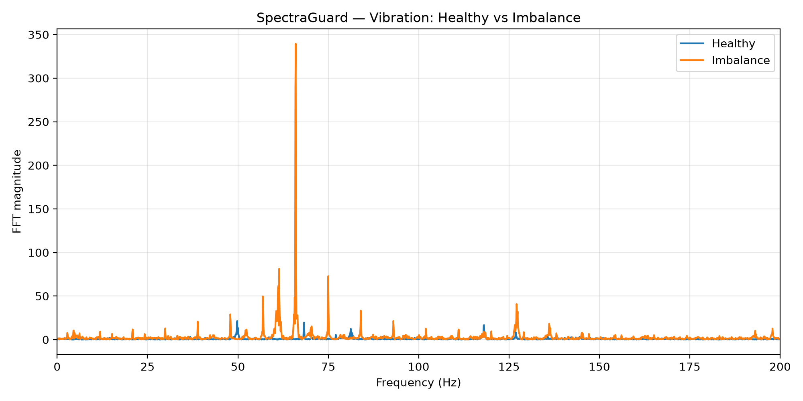
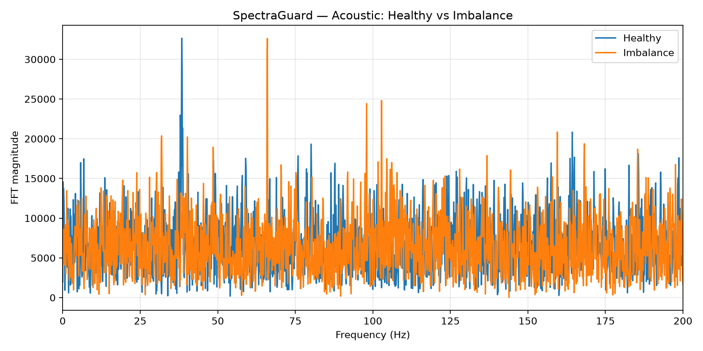

# SpectraGuard

SpectraGuard is a single-node vibration-and-acoustic condition-monitoring system designed to detect mechanical imbalance in rotating machinery.

The prototype uses an Arduino Due, an ADXL345 accelerometer, and a MAX4466 microphone amplifier to acquire vibration and acoustic data from a small fan. Sensor data is streamed to Python, where Fast Fourier Transform (FFT) analysis and statistical features are used to compare healthy operation with a deliberately induced imbalance.

## Project Goal

The goal is to determine whether a low-cost embedded sensing system can distinguish normal operation from a mechanical imbalance using vibration and acoustic signatures.

The induced fault is intentionally simple: a small added mass on one fan blade creates an imbalance. The project does not attempt to simulate bearing damage or other industrial faults.

## Hardware

- Arduino Due
- ADXL345 3-axis accelerometer
- MAX4466 microphone amplifier breakout
- Small multi-speed fan
- Breadboard and jumper wires

Additional tools were used during setup and validation, including a digital multimeter and Digilent Analog Discovery 3.

## Software

- Arduino IDE
- Python 3
- NumPy
- SciPy
- Matplotlib
- PySerial

## System Architecture

```text
              ADXL345 Accelerometer
                     |
                     | I2C
                     |
                     v
               Arduino Due
                     ^
                     |
                     | Analog input
                     |
              MAX4466 Microphone

                     |
                     | USB Serial
                     v

                  Python
                     |
         +-----------+-----------+
         |                       |
         v                       v
   Signal Processing       Live Dashboard
         |
         +-- RMS
         +-- Crest Factor
         +-- FFT
         +-- Dominant Frequency
         +-- Fault Detection
```

## Data Acquisition

The combined system samples vibration and microphone data at approximately:

**400 samples/second**

Each recorded experiment contains:

**4000 samples = 10 seconds**

The serial stream contains:

```text
timestamp, x-axis, y-axis, z-axis, microphone
```

## Signal Processing

For each signal, SpectraGuard calculates:

- Root Mean Square (RMS) amplitude
- Crest factor
- Fast Fourier Transform (FFT)
- Dominant frequency

The accelerometer measures vibration along three axes.

The microphone provides an independent acoustic measurement that can reveal spectral changes even when overall sound amplitude changes very little.

## Experimental Procedure

Two operating conditions were tested.

### Healthy Condition

The fan was operated at a fixed medium speed with no added imbalance.

### Fault Condition

A small piece of material was securely attached to one fan blade to introduce a controlled imbalance.

Sensor locations, fan speed, sampling rate, and measurement duration were kept unchanged between tests.

## Results

The induced imbalance produced a large increase in measured vibration.

| Signal | Healthy RMS | Fault RMS | Change |
|---|---:|---:|---:|
| X vibration | 0.0352 g | 0.2563 g | +627.8% |
| Y vibration | 0.0607 g | 0.2736 g | +350.6% |
| Z vibration | 0.0413 g | 0.3072 g | +644.4% |
| Microphone | 196.695 ADC | 192.726 ADC | -2.0% |

The vibration fault signature converged near:

**66 Hz**

The acoustic signal produced a different but complementary result:

- microphone RMS changed by only about **2%**
- dominant acoustic frequency shifted from approximately **38.4 Hz to 66.0 Hz**

This demonstrates that overall sound level alone is not sufficient for detecting this fault. Frequency-domain analysis revealed a strong spectral change that RMS amplitude did not.

## Healthy vs. Imbalance Spectra

### Vibration



### Acoustic



## Live Dashboard

The Python dashboard displays:

- live vibration waveform
- live microphone waveform
- vibration FFT
- acoustic FFT
- vibration RMS
- crest factor
- dominant frequencies
- HEALTHY / IMBALANCE DETECTED status

The prototype detection threshold is derived from experimentally measured healthy and fault reference datasets.

## Repository Structure

```text
Spectraguard/
├── arduino/
│   ├── spectraguard_due/
│   │   └── spectraguard_due.ino
│   └── i2c_scanner/
│       └── i2c_scanner.ino
├── python/
│   ├── capture_baseline.py
│   ├── capture_fault.py
│   ├── capture_combined_baseline.py
│   ├── capture_combined_fault.py
│   ├── fft_analysis.py
│   ├── compare_baseline_fault.py
│   ├── compare_combined.py
│   └── dashboard.py
├── data/
│   ├── baseline/
│   └── fault/
├── figures/
├── hardware/
├── docs/
├── media/
└── README.md
```

## Running the Dashboard

Activate the Python virtual environment:

```bash
source .venv/bin/activate
```

Move to the Python directory:

```bash
cd python
```

Run:

```bash
python dashboard.py
```

The Arduino Serial Monitor must be closed while Python accesses the serial port.

## Key Findings

1. The accelerometer clearly detected the induced rotating imbalance.
2. Vibration RMS increased by several hundred percent under the fault condition.
3. The fault produced a strong spectral component near 66 Hz.
4. Acoustic RMS alone did not clearly identify the fault.
5. Acoustic FFT analysis revealed the same approximately 66 Hz fault signature.
6. Vibration and acoustic sensing provided complementary information.

## Limitations

This prototype uses a small fan and an intentionally induced blade imbalance rather than industrial machinery or naturally occurring mechanical faults.

The combined acquisition rate is 400 Hz, limiting analysis to frequencies below approximately 200 Hz according to the Nyquist criterion.

Because the microphone channel is also sampled at 400 Hz in the combined acquisition mode, the present acoustic analysis is limited to low-frequency spectral content. A higher microphone sampling rate or dedicated anti-alias filtering would improve future acoustic measurements.

The present detector was evaluated using a limited number of controlled trials. The current threshold should therefore be considered a prototype demonstration rather than a validated industrial fault-classification system.

## Future Development

Potential extensions include:

- repeated trials across multiple fan speeds
- statistical validation of detection thresholds
- harmonic-band energy features
- higher-rate acoustic sampling
- improved analog anti-alias filtering
- automatic calibration
- more advanced fault classification
- custom Arduino Due shield PCB
- optional FPGA-based signal-processing acceleration

## Project Ownership

This project was designed and built as a student engineering project by Ryan Abdalla. Ryan performed the hardware assembly, testing, software execution, experimentation, and analysis with technical mentorship and design review from a parent with an electrical engineering background.
